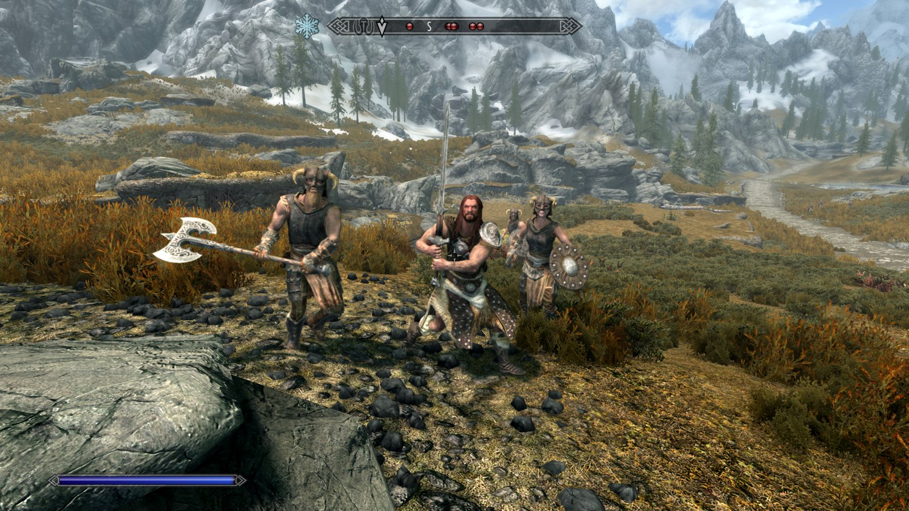
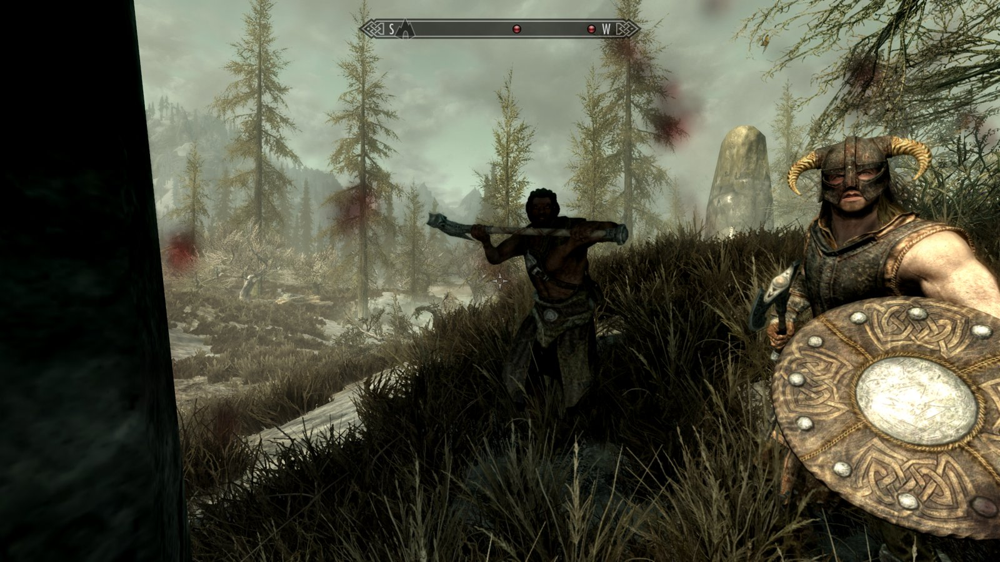
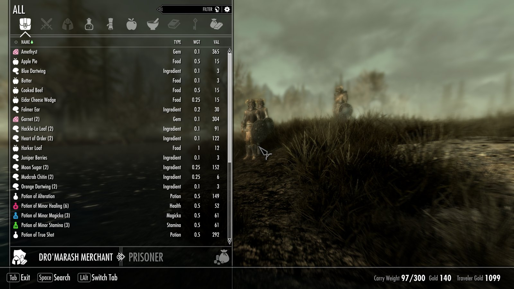

# A-Life for Skyrim SE (Anomaly edition)

A persistent, simulated world for Skyrim Special Edition, after STALKER Anomaly's A-Life. Factions keep squads that
live, travel, trade, fight, loot, level up and die all over the map whether you are watching or not, and meet you on
the road with a reason to be there and an opinion of you. An SKSE plugin; no scripts run on a timer.

**Version 2.1.0. Progress: about 87% of the goal** (Anomaly-standard A-Life across all of Skyrim SE). Playable now; see the
[roadmap](#status-and-roadmap) and [docs/CHANGELOG.md](docs/CHANGELOG.md) for what is new and what is still open.



| | |
|---|---|
|  |  |

## Features

- **A living map.** Every location in Skyrim and Solstheim (vanilla, DLC, Creation Club and modded) becomes a *smart
  terrain*: about 350 in Skyrim and 45 on Solstheim. Forts change hands, camps are cleared and retaken.
- **18 factions with squads**: bandits, Forsworn, Legion, Stormcloaks, Thalmor, wanderers, hunters, mercenaries, mages,
  necromancers, vampires, Dawnguard, Silver Hand, Vigilants, Khajiit caravans, and on Solstheim the Skaal, the Redoran Guard and the Reavers, plus wildlife, draugr, falmer,
  giants, hagravens, werewolves and other monsters with lairs. They pick targets, travel, rest, fight off screen and
  respawn from the places they hold. The news feed tells you what happened.
- **Needs and a pack**: squads eat, heal, hunt, fish, rest, trade at real shops (vendors really gain and lose stock),
  raid settlements and clear dungeons.
- **They level with you** and are never scaled down. **They loot** the dead they pass, yours included (after a grace period).
- **Standing, not a hostile switch**: each squad works out its attitude from the Civil War, your race, guilds, clothes,
  bounty, what you did to its people and how dangerous you look.
- **Every encounter is a conversation** in the ordinary dialogue menu: tolls, patrol challenges, news, trade.
- **Tasks** from squad leaders (bounty, assault, delivery, fetch, escort, defend, rescue, recover, the top-10 hunt) with journal
  entries, markers and rewards. **Companions**: friendly squads join, neutral ones for pay.
- **Wounded, help, finish, surrender**, **camp life** at the places squads stay, the **Civil War** and **Solstheim** factions.
- **Difficulty**: follows Skyrim's difficulty, plus one MCM slider per part (population, monsters, squad strength, lethality,
  economy, wounded and surrender, tasks, dragons).
- **Stable over long play**: 120 simulated days, repeated save/load cycles, a CPU budget.

Full player documentation: [docs/README.md](docs/README.md). Design notes: [docs/](docs/).

## Requirements

- Skyrim Special Edition / Anniversary Edition 1.6.x or 1.7.x (built and tested on 1.7.104). **You need your own copy
  of the game: no game files are in this repository.**
- SKSE64 for your game version and the Address Library for SKSE Plugins.
- SkyUI 5.2 SE for the MCM.
- The official DLCs (Dawnguard is a master; Dragonborn adds Solstheim).

## Install

Download the release archive from the [Releases](../../releases) page.

**Mod Organizer 2**: *Install a new mod from an archive*, pick the zip, enable it in the left pane, and check the three
plugins (`ALife.esp`, `ALifeFactions.esp`, `ALifeTalk.esp`) in the right pane. Launch SKSE from MO2.

**Vortex**: drag the zip onto the *Mods* page (or *Install From File*), click *Enable*, then *Deploy*. Launch through SKSE.

Load order: anywhere after the master files. Configure it in MCM > A-Life. To uninstall: MCM > A-Life > Prepare to
uninstall, save, quit, then remove the mod.

## Build from source

Visual Studio 2022 (C++ desktop workload), CMake, [vcpkg](https://github.com/microsoft/vcpkg) and
[CommonLibSSE-NG](https://github.com/alandtse/CommonLibVR/tree/ng).

```powershell
$env:ALIFE_CLIB = "C:\path\to\CommonLibSSE-NG"; $env:VCPKG_ROOT = "C:\path\to\vcpkg"
powershell -File build.ps1 -Config Release
```

The core simulation also builds without the game: `tests\build_harness.bat` builds a headless harness that runs the
whole A-Life board against a world dump (see `tests/`). `tools/package.py` assembles and lints the release archive: it builds all three plugins from this checkout and your
Skyrim.esm (`tools/esp/build_esp.py`, `tools/build_factions_esp.py`, `tools/build_talk_esp.py`), takes only the FaceGen from the
previous release (`--base-zip`), and runs `tools/publish_lint.py` and `tools/mcm_check.py`.

## Layout

- `src/`, `include/ALife/`: the plugin. `src/core/` is the engine-free simulation (board, factions, smart terrains,
  standing, tasks) that the headless tests build on their own.
- `config/*.ltx`: all tuning, in Anomaly's LTX dialect (squads, places, relations, standing, tasks, dialogue).
- `papyrus/`: the MCM and task scripts. `tools/`: plugin generators, data dumps, packaging. `tests/`: headless tests.

## Status and roadmap

Version 2.1. **Overall progress: about 87%** (89 of 102 weighted points). Everything marked done is in the current
build and was checked in game; "built" means in the build with headless tests passing, the in-game check still open.

| Milestone | Weight | Status |
|---|---|---|
| Core brain: LTX configs, factions and relations, smart terrains, targeting, respawn, news, headless harness | 15 | done |
| Plugin integration: all of Tamriel as one graph, online/offline, co-save, MCM, debug lab | 10 | done |
| 2.0 content: 15 factions, ~200 squads, standing, real dialogue, barter, caravans, Solstheim, scavenging | 15 | done |
| Play-test and stability fixes | 8 | done |
| Mutants and monsters with lairs (wildlife, draugr, falmer, zombies) | 12 | done |
| Remaining monsters (death hounds, rieklings, werewolves, hagravens, giants, chaurus, Dwemer, ...) | 4 | done |
| Long-run balance and stability (online radius, 120-day sim, save/load cycles) | 5 | done |
| Tasks from squad leaders (bounty, assault, delivery, fetch) | 11 | done |
| Living news and lair hunters | 2 | done |
| Companions and recruiting | 7 | done |
| Dragons as A-Life actors (MCM toggle) | 4 | open |
| Wounded, help, finish, surrender | 5 | built |
| More tasks: escort, defend, rescue, recover, hunts and rankings | 5 | built |
| Stashes | 3 | open |
| Camp life | 1 | built |
| Installable package (full MCM, clean release zip, fresh-profile install test) | 5 | in progress (2.1.0 release candidate) |

See [CONTRIBUTING.md](CONTRIBUTING.md) to help.

## Credits

- Design after **STALKER Anomaly**'s A-Life (Anomaly 1.5.3). This is an independent reimplementation in C++: no code
  or files from Anomaly or GSC are included.
- Built on [CommonLibSSE-NG](https://github.com/alandtse/CommonLibVR/tree/ng), [SKSE64](https://skse.silverlock.org/),
  the Address Library for SKSE Plugins and SkyUI.
- AI disclosure: written by AI coding agents (Anthropic's Claude, in Claude Code), directed and play-tested by the author; a few
  early commits came from xAI's Grok and were reviewed and kept. Dialogue and campfire stories are fixed text in `config/`; A-Life
  uses no AI model at runtime. Features marked done were verified in the real game.

Not affiliated with Bethesda, GSC Game World or the Anomaly team. All trademarks belong to their owners.

## License

MIT, see [LICENSE](LICENSE).
